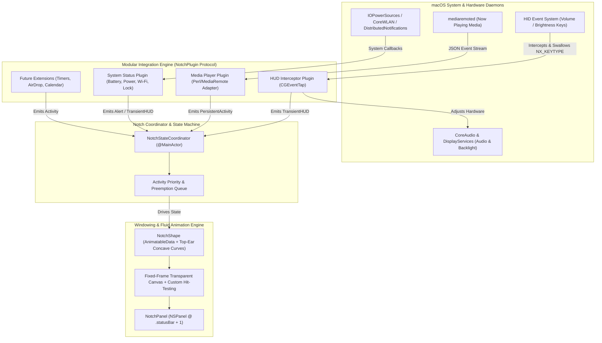

# MacBook Dynamic Island — Architecture & Design Specification

## 1. System Overview & Core Mechanics

A macOS Dynamic Island ("Notch" extension) creates the illusion that the physical camera cutout on Apple Silicon MacBooks can dynamically morph, expand, and display live contextual activities. Because macOS does not provide a native `SpringBoard` Dynamic Island API, the application achieves this through a carefully coordinated combination of borderless high-level `AppKit` windows, `SwiftUI` spring-animated shapes, and low-level system event hooks.



---

## 2. Windowing, Geometry & Fluid Animation Architecture

### 2.1 Exact Notch Geometry Detection
macOS exposes the exact coordinates of the usable menu bar regions to the left and right of the physical camera housing via [`NSScreen`](https://developer.apple.com/documentation/appkit/nsscreen):
- `screen.safeAreaInsets.top > 0` confirms a physical notch is present on the display.
- `screen.auxiliaryTopLeftArea` and `screen.auxiliaryTopRightArea` return the `NSRect` frames flanking the hardware cutout.
- **Exact Notch Frame Calculation**:
  - `notchOriginX = auxiliaryTopLeftArea.maxX`
  - `notchWidth = auxiliaryTopRightArea.minX - auxiliaryTopLeftArea.maxX`
  - `notchHeight = screen.frame.maxY - auxiliaryTopLeftArea.maxY` (or fallback to `safeAreaInsets.top`)
- **Non-Notch Fallback & Multi-Monitor Selection**:
  - Configurable in Settings (`Automatic / Built-in Display Only / Specific Display / Follow Active Cursor`).
  - On external monitors or older MacBooks where `safeAreaInsets.top == 0`, the geometry calculator synthesizes a sleek centered floating pill (`~180pt × 30pt`) pinned to the top-center of `screen.frame` as the resting/hover zone.

### 2.2 The Fixed-Canvas Window Trick (Zero-Jitter Animations)
Calling `NSWindow.setFrame(_:display:animate:)` at 120Hz during spring animations causes severe layout thrashing and edge jitter in AppKit.
Instead, we use a **Fixed-Size Transparent Canvas**:
1. **Window Subclass (`NotchPanel: NSPanel`)**:
   - Sized once to the **maximum possible expanded bounding box** (e.g., `600pt × 260pt`), horizontally centered on the notch and pinned to `screen.frame.maxY`.
   - Configured with:
     - `styleMask = [.borderless, .nonactivatingPanel, .fullSizeContentView]`
     - `level = NSWindow.Level(rawValue: Int(CGWindowLevelForKey(.statusWindow)) + 1)` (floats above the menu bar and full-screen apps).
     - `collectionBehavior = [.canJoinAllSpaces, .stationary, .fullScreenAuxiliary, .ignoresCycle]`
     - `backgroundColor = .clear`, `isOpaque = false`, `hasShadow = false` (shadows are rendered inside SwiftUI so they morph dynamically with the shape).
2. **Dynamic Click-Through (`hitTest(_:)` Override)**:
   - Because the `600×260` window covers the top center of the screen, it would block clicks to underlying apps if left unhandled.
   - The root `NSHostingView` overrides `hitTest(_ point: NSPoint) -> NSView?` and checks whether `point` lies inside the **current animated path** of the notch (`currentNotchRect.contains(point)`).
   - If outside the current black shape, `hitTest` returns `nil`, making the transparent region 100% click-through to the menu bar and apps below.

### 2.3 Custom Bezier Notch Shape & 120Hz ProMotion Springs
As shown in your screenshots, the top edge of the notch does not end at a hard `90°` corner—it has smooth **concave "top ears"** that flare outward into the top edge of the screen, while the bottom corners have convex rounded radii.

- **`NotchSilhouetteShape: Shape`**:
  - Draws a continuous path starting at `(midX - width/2 - topEarRadius, topY)`:
    1. **Top-Left Ear**: Quad-curve / arc curving inward and down into the left vertical wall.
    2. **Bottom-Left Corner**: Continuous (`G2` / `.continuous`) rounded corner of radius `bottomCornerRadius`.
    3. **Bottom-Right Corner**: Continuous rounded corner of radius `bottomCornerRadius`.
    4. **Top-Right Ear**: Quad-curve flaring upward and outward back to `topY`.
  - Conforms to `Animatable` with `AnimatablePair<CGFloat, AnimatablePair<CGFloat, CGFloat>>` (`width`, `height`, `bottomCornerRadius`) so SwiftUI interpolates the path geometry on every 120Hz ProMotion display refresh tick.
- **Spring Physics Profiles**:
  - **Hover / Expansion**: `.spring(response: 0.36, dampingFraction: 0.78, blendDuration: 0.1)` — slight organic overshoot when popping open.
  - **Collapse / Dismissal**: `.spring(response: 0.30, dampingFraction: 0.88, blendDuration: 0.1)` — crisp settle back into the physical bezel with no bounce clipping into the hardware notch.
  - **Content Transitions**: Paired with `.matchedGeometryEffect` for album artwork, icons, and waveform visualizers, plus `.transition(.blurReplace.combined(with: .scale(0.92)).combined(with: .opacity))`.

---

## 3. Low-Level System Integrations & Permission Mechanics

### 3.1 System HUD Replacement (Volume, Brightness, Backlight)
In macOS Sequoia and macOS Tahoe, pressing Volume or Brightness keys dispatches a hardware HID event (`NSSystemDefined`, subtype `8` / `NX_SUBTYPE_AUX_CONTROL_BUTTONS`) that `OSDUIHelper` / `ControlCenter` intercepts to display the system HUD (the corner liquid-glass pill in Tahoe).

To replace the system HUD cleanly like Alcove:
1. **Accessibility Permission (`AXIsProcessTrustedWithOptions`)**:
   - Required to attach a `.defaultTap` (active filter) at `.cghidEventTap`.
   - When the user toggles on Sound or Display HUD replacement, the app checks `AXIsProcessTrusted()`. If false, it displays the custom popover (`"Needs your permission to replace the system HUDs"`) and opens `x-apple.systempreferences:com.apple.preference.security?Privacy_Accessibility`.
2. **Swallowing the Event (`CGEventTap`)**:
   - The `CGEventTap` callback inspects `NSEvent(cgEvent: event)` where `subtype == 8`.
   - Extracts `keyCode = (data1 & 0xFFFF0000) >> 16` and `keyState = ((data1 & 0x0000FFFF) & 0xFF00) >> 8`.
   - For `NX_KEYTYPE_SOUND_UP (0)`, `NX_KEYTYPE_SOUND_DOWN (1)`, `NX_KEYTYPE_MUTE (10)`, `NX_KEYTYPE_BRIGHTNESS_UP (2)`, and `NX_KEYTYPE_BRIGHTNESS_DOWN (3)`:
     - Returns `nil` from the tap callback. Returning `nil` **swallows the event before macOS sees it**, completely suppressing the native liquid-glass HUD.
3. **Applying the Hardware Adjustment Directly**:
   - Because swallowing the key event also prevents macOS from changing the volume or brightness automatically, our service immediately applies the delta:
     - **Audio Volume**: Uses `CoreAudio` (`AudioObjectGetPropertyData` / `AudioObjectSetPropertyData` with `kAudioHardwareServiceDeviceProperty_VirtualMainVolume` and `kAudioDevicePropertyMute` on the default output device). Supports `Option + Shift` quarter-step increments (`1/64` vs `1/16`).
     - **Display Brightness**: Dynamically loads `/System/Library/PrivateFrameworks/DisplayServices.framework/DisplayServices` via `dlopen` and calls `DisplayServicesGetBrightness` / `DisplayServicesSetBrightness(CGMainDisplayID(), newBrightness)`.
4. **Tap Timeout Watchdog**:
   - If macOS ever disables the event tap due to system load (`type == .tapDisabledByTimeout`), the callback immediately re-enables it via `CGEvent.tapEnable(tap: tap, enable: true)` and keeps the callback under `< 0.1ms` by dispatching hardware/UI updates asynchronously.

### 3.2 Universal "Now Playing" Media Integration (Spotify, Apple Music, Browsers)
Your screenshot shows album art, track title, artist, elapsed/remaining timestamps, progress scrubber, transport controls, output device icon, and an animated audio equalizer on the right wing.

> [!IMPORTANT]
> **macOS 15.4+ / Tahoe `MediaRemote` Entitlement Constraint:**
> Starting in macOS 15.4 and continuing in macOS Tahoe, Apple's `mediaremoted` daemon rejects direct `MRMediaRemoteGetNowPlayingInfo` calls from unsigned/third-party app processes unless called through an entitled system binary.

To support **all media sources universally** (Spotify, Apple Music, YouTube in Safari/Chrome/Arc/Dia, SoundCloud, podcasts) without requiring users to disable SIP:
- **Primary Engine (System MediaRemote Adapter)**:
  - Bundles a lightweight helper dynamic library invoked via a persistent `/usr/bin/perl` subprocess stream (following the proven `mediaremote-adapter` pattern used by modern macOS notch apps).
  - Streams real-time JSON diffs whenever playback state, track metadata, elapsed time, or base64 album artwork changes, and sends transport commands (`MRMediaRemoteSendCommand` for play, pause, next, previous, seek, shuffle) back through the pipe.
- **Secondary Fallback (ScriptingBridge / AppleScript)**:
  - Optional direct `NSAppleEventDescriptor` bridge for Spotify and Apple Music if specific extra metadata (like Spotify `isSaved` or shuffle state) is needed.
- **Dominant Color Extraction**:
  - Whenever album artwork changes, an image analyzer extracts the primary vibrant accent color (`CIImage` area average / k-means palette) to tint the equalizer bars and ambient glow inside the notch.

### 3.3 Lock Screen, Battery, Power & Wi-Fi Integrations
- **Lock Screen Widget**:
  - Observes `DistributedNotificationCenter.default()` for `com.apple.screenIsLocked` and `com.apple.screenIsUnlocked`.
  - Renders at window level `.screenSaver` (`1000+`) so the notch expansion and animated 3D/SF-Symbol lock icon (`lock.open.fill` <-> `lock.fill`) are visible during the lock/unlock transition.
- **Battery, Charging & Low Power Mode**:
  - Registers a run-loop callback via `IOPSCopyPowerSourcesInfo` and `IOPSNotificationCreateRunLoopSource` (`IOKit.ps`) for instant AC plug/unplug events and battery percentage thresholds (e.g., 20%, 10% Low Battery warning).
  - Observes `NSNotification.Name.NSProcessInfoPowerStateDidChange` (`ProcessInfo.processInfo.isLowPowerModeEnabled`) to trigger the Low Power Mode pill indicator.
- **Wi-Fi Connectivity**:
  - Uses `NWPathMonitor(requiredInterfaceType: .wifi)` (`Network.framework`) combined with `CWWiFiClient.shared()` (`CoreWLAN`) to detect Wi-Fi toggles and connection changes in real time without requiring Location Services permission.

---

## 4. Modular Plugin Architecture & State Machine

To make the application a true "Swiss Army Knife" that is easy to extend with new integrations, the core engine knows **nothing** about Spotify, Volume, or Battery. Instead, everything is a plugin conforming to `NotchPlugin`.

### 4.1 Notch Visual States
Every activity rendered in the notch maps to one of four layout postures:
1. **`resting` (Idle)**: Hidden (`0 opacity` or exact size of physical hardware notch).
2. **`compactWings` (Persistent Background Activity)**: The notch widens horizontally (`~280pt–340pt`) while staying the exact height of the menu bar (`~32pt–38pt`). Left wing shows compact context (e.g., tiny spinning/rounded album art); right wing shows a live indicator (e.g., animated audio waveform bars).
3. **`transientHUD` (System Event Banner)**: Temporarily widens or drops down slightly (`~320pt × 48pt`) for `1.8s` to show Volume, Brightness, Wi-Fi, Power Saver, or Lock state, then smoothly springs back to `compactWings` or `resting`.
4. **`expandedCard` (Interactive Drawer)**: Triggered when hovering over the notch for `50ms` (with subtle scale pre-tension during the `50ms` window, just like pressing on it) or immediately on click. Morphs into a full card (`~380pt × 190pt`) showing full media controls, sliders, or multi-tab widgets. Collapses automatically when the cursor exits the padded tracking area.

### 4.2 Core Protocol Contract (`NotchPlugin`)

```swift
import SwiftUI
import Combine

public enum NotchPriority: Int, Comparable {
    case background = 10   // Persistent Now Playing, background timers
    case normal = 50       // Wi-Fi toggle, Bluetooth connected
    case high = 80         // Volume / Brightness HUD
    case critical = 100    // Low Battery (10%), Screen Lock / Unlock
    
    public static func < (lhs: Self, rhs: Self) -> Bool { lhs.rawValue < rhs.rawValue }
}

public enum NotchPresentationMode {
    case idle
    case compactWings(leading: AnyView, trailing: AnyView)
    case transientHUD(content: AnyView, duration: TimeInterval)
    case expandedCard(content: AnyView)
}

@MainActor
public protocol NotchPlugin: AnyObject, Identifiable {
    var id: String { get }
    var displayName: String { get }
    var isEnabled: Bool { get set }
    
    /// Called when the app starts or the plugin is enabled in Settings
    func start(coordinator: NotchActivityCoordinator)
    
    /// Called when the plugin is disabled or app terminates
    func stop()
    
    /// Optional settings view injected into the Preferences window
    var settingsView: AnyView? { get }
}
```

### 4.3 Priority & Preemption Rules in `NotchActivityCoordinator`
- **Transient Preemption**: If `MediaPlugin` is displaying `compactWings` (album art + waveform) and the user presses Volume Up (`HUDPlugin`, `.high` priority), the notch smoothly morphs from `compactWings` -> `transientHUD` (Sound bar). Each subsequent Volume key press resets the `1.8s` auto-dismiss timer. When the timer expires, it morphs back to `compactWings`.
- **Hover Override**: If the user hovers over the notch while `MediaPlugin` is active, it transitions to `expandedCard`. If the user presses Volume Up *while* `expandedCard` is open, either a mini volume bar overlays inside the card or the HUD waits until hover ends (configurable).

---

## 5. Proposed Project Structure

```text
Island/
├── App/
│   ├── IslandApp.swift                  # @main entry, MenuBarExtra + Settings scene
│   ├── AppDelegate.swift                # NSApp.setActivationPolicy(.accessory), lifecycle
│   └── Entitlements/
│       └── Island.entitlements          # Non-sandboxed (Hardened Runtime) for CGEventTap
├── Core/
│   ├── Window/
│   │   ├── NotchPanel.swift             # Borderless NSPanel, statusWindow+1 level
│   │   ├── NotchHitTestView.swift       # NSHostingView subclass with dynamic path hit-testing
│   │   └── ScreenGeometryMonitor.swift  # NSScreen auxiliaryTopLeft/Right observer
│   ├── Animation/
│   │   ├── NotchSilhouetteShape.swift   # Custom Shape with top-ear concave quad-curves
│   │   └── SpringPresets.swift          # Tuned 120Hz ProMotion spring parameters
│   ├── Coordinator/
│   │   ├── NotchStateCoordinator.swift  # State machine, hover debounce, priority preemption
│   │   └── NotchPluginRegistry.swift    # Registers, starts/stops, and persists plugin state
│   └── Permissions/
│       └── AccessibilityManager.swift   # AXIsProcessTrusted check, polling & prompt UI
├── SystemBridges/
│   ├── HIDEventTapService.swift         # CGEventTap for NX_KEYTYPE volume/brightness
│   ├── AudioControlService.swift        # CoreAudio default output volume & mute control
│   ├── BrightnessControlService.swift   # Dynamic dlopen wrapper for DisplayServices
│   └── MediaRemoteBridge/
│       ├── MediaRemoteStreamService.swift # AsyncSequence JSON reader from adapter
│       └── Resources/                   # Bundled perl/dylib adapter for mediaremoted
├── Plugins/
│   ├── NotchPlugin.swift                # Protocol definitions & activity models
│   ├── HUD/
│   │   ├── SystemHUDPlugin.swift        # Sound & Display notch HUD views + progress bar
│   │   └── HUDPermissionPopover.swift   # "Needs your permission to replace system HUDs"
│   ├── Media/
│   │   ├── NowPlayingPlugin.swift       # Compact wings + Expanded music card + equalizer
│   │   └── AudioWaveformView.swift      # Smooth multi-bar animated visualizer
│   ├── PowerAndLock/
│   │   ├── BatteryPowerPlugin.swift     # Charging, Low Battery, Low Power Mode HUDs
│   │   └── LockScreenPlugin.swift       # Screen lock/unlock animated padlock widget
│   └── Connectivity/
│       └── WiFiStatusPlugin.swift       # Network.framework + CoreWLAN status HUD
├── SettingsUI/
│   ├── SettingsWindowView.swift         # Alcove-inspired dark settings window
│   └── GeneralSettingsView.swift
└── Scripts/
    └── build-dmg.sh                     # Automated .app archive & .dmg packaging script
```

---

## 6. Phased Implementation Plan & Task List

### Phase 1: Core Notch Window, Geometry & Morphing Shell
- [ ] Initialize native macOS Swift/SwiftUI project (`macOS 14.0+` deployment target, compatible through macOS Tahoe).
- [ ] Implement `ScreenGeometryMonitor` to read `auxiliaryTopLeftArea` and `auxiliaryTopRightArea`, handling display reconfiguration and fallback pill geometry for non-notched displays.
- [ ] Build `NotchPanel` (`NSPanel`) and `NotchHitTestView` so the window sits flush in the menu bar / notch layer with zero click-blocking outside the active black silhouette.
- [ ] Implement `NotchSilhouetteShape` with concave top ears and continuous bottom corners, plus hover tracking (`NSTrackingArea`) with pre-expansion tension (`scaleEffect`) and spring transitions between `resting`, `compactWings`, `transientHUD`, and `expandedCard`.
- [ ] Write unit tests for `ScreenGeometryMonitor` coordinate calculations and `NotchStateCoordinator` priority preemption transitions.

### Phase 2: Plugin Engine & System Status Widgets (Lock, Power, Wi-Fi)
- [ ] Implement `NotchPlugin` protocol, `NotchActivityCoordinator` priority queue, and auto-dismiss timers.
- [ ] Implement `LockScreenPlugin` observing `com.apple.screenIsLocked` / `com.apple.screenIsUnlocked` with an animated padlock icon.
- [ ] Implement `BatteryPowerPlugin` (`IOKit.ps` + `NSProcessInfoPowerStateDidChange`) for Charger connected, Low Battery warnings, and Low Power Mode toggles.
- [ ] Implement `WiFiStatusPlugin` (`NWPathMonitor`) for Wi-Fi on/off transient notifications.

### Phase 3: Accessibility Permissions & System HUD Replacement (Sound & Display)
- [ ] Build `AccessibilityManager` to check `AXIsProcessTrusted()`, prompt the user with the permission popover (matching your screenshot), deep-link into `System Settings > Accessibility`, and auto-detect when the toggle is enabled.
- [ ] Build `HIDEventTapService` (`CGEventTap` at `.cghidEventTap`) to intercept and swallow `NX_KEYTYPE_SOUND_UP/DOWN/MUTE` and `NX_KEYTYPE_BRIGHTNESS_UP/DOWN` (hiding the native liquid glass HUD).
- [ ] Build `AudioControlService` (`CoreAudio`) and `BrightnessControlService` (`DisplayServices`) to apply hardware steps and emit `transientHUD` updates with the smooth horizontal progress bar.

### Phase 4: Universal Now Playing Media Integration
- [ ] Implement `MediaRemoteStreamService` to stream universal Now Playing metadata (Spotify, Apple Music, Safari/Chrome/Arc/Dia browser audio) and dispatch playback commands (play/pause, skip, seek, shuffle).
- [ ] Build `NowPlayingPlugin` Views:
  - **Compact Wings**: Mini album cover on left of physical notch, animated color-matched equalizer bars on right.
  - **Expanded Card (Hover/Click)**: Full artwork, track title/artist, interactive progress scrubber with elapsed/remaining time, transport buttons, and audio output route indicator.

### Phase 5: Settings UI & Native `.dmg` Packaging
- [ ] Create the Menu Bar icon (`MenuBarExtra`) and a dark-themed Settings window to toggle individual plugins, configure hover sensitivity, and manage permissions.
- [ ] Create `Scripts/build-dmg.sh` to compile a Release `.app` bundle and package it into a distributable `.dmg` disk image.
