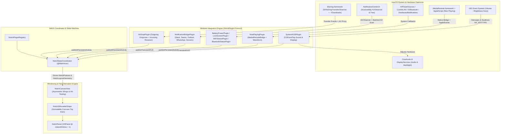

# MacBook Dynamic Island — Architecture & Design Specification

## 1. System Overview & Core Mechanics

**Island** is a macOS Dynamic Island ("Notch" extension) that turns the physical camera cutout on Apple Silicon MacBooks (and a floating top-center pill on external displays) into a fluidly animated contextual activity surface. Because macOS does not provide a native `SpringBoard` Dynamic Island API, Island coordinates borderless high-level `AppKit` windows, `SwiftUI` 120Hz spring-animated shapes, and low-level system event hooks.



---

## 2. Windowing, Geometry & Fluid Animation Architecture

### 2.1 Exact Notch Geometry Detection
macOS exposes the usable menu bar regions flanking the physical camera housing via [`NSScreen`](https://developer.apple.com/documentation/appkit/nsscreen) in [`ScreenGeometryMonitor.swift`](file:///Users/erencankanmaz/Documents/island/Sources/IslandCore/Window/ScreenGeometryMonitor.swift):
- `screen.safeAreaInsets.top > 0` confirms a physical notch is present on the display.
- `screen.auxiliaryTopLeftArea` and `screen.auxiliaryTopRightArea` return the `NSRect` frames to the left and right of the hardware cutout.
- **Exact Notch Frame Calculation**:
  - `notchOriginX = auxiliaryTopLeftArea.maxX`
  - `notchWidth = auxiliaryTopRightArea.minX - auxiliaryTopLeftArea.maxX`
  - `notchHeight = screen.frame.maxY - auxiliaryTopLeftArea.maxY` (or fallback to `safeAreaInsets.top`)
- **Non-Notch Fallback & Multi-Monitor Selection**:
  - Configurable in Settings (`Automatic / Follow Active Cursor / Specific Display`).
  - On external monitors without a hardware cutout (`safeAreaInsets.top == 0`), [`ScreenGeometryMonitor`](file:///Users/erencankanmaz/Documents/island/Sources/IslandCore/Window/ScreenGeometryMonitor.swift) synthesizes a top-center floating pill (`188pt × 32pt`) pinned to `screen.frame.maxY`.
  - User-tunable width (`notchWidthAdjustmentPx`), height (`notchHeightAdjustmentPx`), and hover exit margin (`hoverExitMarginPx`) with live visual calibration guides.

### 2.2 Fixed-Canvas Window & Asymmetric Wing Layout
Calling `NSWindow.setFrame(_:display:animate:)` at 120Hz during spring animations causes edge jitter in AppKit. Instead, [`NotchPanel.swift`](file:///Users/erencankanmaz/Documents/island/Sources/IslandCore/Window/NotchPanel.swift) and [`NotchWindowController.swift`](file:///Users/erencankanmaz/Documents/island/Sources/IslandCore/Window/NotchWindowController.swift) use a **Fixed-Size Transparent Canvas**:
1. **Window Subclass (`NotchPanel: NSPanel`)**:
   - Sized to a fixed `560pt × 270pt` canvas centered on the physical notch and pinned to `screen.frame.maxY`.
   - Configured with `styleMask = [.borderless, .nonactivatingPanel, .fullSizeContentView]`, `level = .statusWindow + 1` (rising to `.screenSaver + 1` when the lock screen is active), and `collectionBehavior = [.canJoinAllSpaces, .stationary, .fullScreenAuxiliary, .ignoresCycle]`.
2. **Independent Left & Right Wing Sizing (`NotchWingSizes`)**:
   - Activities specify independent `leftWidth` and `rightWidth` values (e.g., a `36pt` leading app icon wing paired with a dynamic content-fitted trailing text wing up to `maxWingWidth`).
   - [`NotchLayoutGeometry.horizontalCenterOffset`](file:///Users/erencankanmaz/Documents/island/Sources/IslandCore/Coordinator/NotchStateCoordinator.swift#L50-L52) shifts the silhouette by `(rightWingWidth - leftWingWidth) / 2.0` so each wing extends from its respective side of the physical camera cutout without shifting the center dead-zone.
3. **Click-Through & Hover Tracking**:
   - While in `.resting`, `.compactWings`, or `.transientHUD`, `panel.ignoresMouseEvents = true` so clicks outside or around the menu bar pass straight through to underlying apps, while a `CFRunLoop` cursor tracker monitors hover entry/exit against the current animated silhouette rect.
   - When expanded (`.expandedCard`), `panel.ignoresMouseEvents = false` so interactive controls inside the card receive mouse clicks directly.

### 2.3 Custom Bezier Notch Shape & 120Hz ProMotion Springs
[`NotchSilhouetteShape.swift`](file:///Users/erencankanmaz/Documents/island/Sources/IslandCore/Animation/NotchSilhouetteShape.swift) draws a continuous path with smooth **concave top ears** that flare into the top edge of the screen and convex rounded bottom corners:
- Conforms to `Animatable` across `topEarRadius` and `bottomCornerRadius` so SwiftUI interpolates the silhouette on every 120Hz ProMotion refresh tick.

---

## 3. Low-Level System Integrations & Permission Mechanics

### 3.1 System HUD Replacement (Volume, Brightness)
Implemented in [`HIDEventTapService.swift`](file:///Users/erencankanmaz/Documents/island/Sources/IslandCore/SystemBridges/HIDEventTapService.swift), [`AudioControlService.swift`](file:///Users/erencankanmaz/Documents/island/Sources/IslandCore/SystemBridges/AudioControlService.swift), [`BrightnessControlService.swift`](file:///Users/erencankanmaz/Documents/island/Sources/IslandCore/SystemBridges/BrightnessControlService.swift), and [`SystemHUDPlugin.swift`](file:///Users/erencankanmaz/Documents/island/Sources/IslandCore/Plugins/HUD/SystemHUDPlugin.swift):
1. **Accessibility Permission (`AccessibilityManager`)**:
   - Checks `AXIsProcessTrusted()` and deep-links to `System Settings > Privacy & Security > Accessibility` when required.
2. **Swallowing Hardware Key Events (`CGEventTap`)**:
   - Intercepts `NSSystemDefined` (`subtype == 8` / `NX_SUBTYPE_AUX_CONTROL_BUTTONS`) for Volume Up/Down/Mute and Brightness Up/Down, returning `nil` from the tap callback to suppress the native macOS HUD.
3. **Direct Hardware Adjustment**:
   - **Audio Volume**: Uses `CoreAudio` (`kAudioHardwareServiceDeviceProperty_VirtualMainVolume` and `kAudioDevicePropertyMute`) on the default output device.
   - **Display Brightness**: Dynamically loads `DisplayServices.framework` via `dlopen` (`DisplayServicesGetBrightness` / `DisplayServicesSetBrightness`).

### 3.2 Universal "Now Playing" Media Integration
Implemented in [`MediaRemoteBridge.m`](file:///Users/erencankanmaz/Documents/island/Scripts/MediaRemoteBridge.m), [`MediaRemoteStreamService.swift`](file:///Users/erencankanmaz/Documents/island/Sources/IslandCore/SystemBridges/MediaRemoteStreamService.swift), and [`NowPlayingPlugin.swift`](file:///Users/erencankanmaz/Documents/island/Sources/IslandCore/Plugins/Media/NowPlayingPlugin.swift):
- **Native MediaRemote Bridge (`libIslandMediaRemoteBridge.dylib`) + AppleEvents Fallback**:
  - Interfaces with `MediaRemote.framework` and falls back to `NSAppleScript` queries for `Spotify` and `Music` on macOS 15.4+ / macOS 26 where direct `mediaremoted` XPC reads are restricted.
- **Track Change Reveal & Dynamic Equalizer**:
  - Temporarily expands the left wing on track changes to slide in the new track title and artist with an accent glow pulse, paired with a 5-bar `AudioWaveformView` (`Calm`, `Medium`, `Intense`) tinted by dominant album artwork color extraction.

### 3.3 App Notification Bridge & Native Banner Suppression
Implemented in [`NotificationBridgePlugin.swift`](file:///Users/erencankanmaz/Documents/island/Sources/IslandCore/Plugins/Notifications/NotificationBridgePlugin.swift), [`NotificationBannerScanner.swift`](file:///Users/erencankanmaz/Documents/island/Sources/IslandCore/SystemBridges/NotificationBannerScanner.swift), [`NotificationBannerDismisser.swift`](file:///Users/erencankanmaz/Documents/island/Sources/IslandCore/SystemBridges/NotificationBannerDismisser.swift), and `Sources/IslandCore/Plugins/Notifications/`:
1. **Accessibility Scanner (`NotificationBannerScanner`)**:
   - Attaches an `AXObserver` to `com.apple.notificationcenterui` (`kAXWindowCreatedNotification`, `kAXCreatedNotification`, `kAXUIElementDestroyedNotification`, `kAXLayoutChangedNotification`, `kAXApplicationShownNotification`, `kAXFocusedUIElementChangedNotification`) backed by a `40 ms` fallback timer.
   - Reads traversal attributes in a single IPC round-trip per element via `AXUIElementCopyMultipleAttributeValues`.
   - **Structural Tray Detection**: Skips any `AXScrollArea` containing `AXOpaqueProviderGroup` (the Notification Center widget grid) and marks `trayIsOpen = true`, ensuring historical cards inside the slide-out Notification Center tray are never mistaken for live banners.
2. **Zero-Flash Offscreen Window Parking (`NotificationBannerDismisser`)**:
   - Because `com.apple.notificationcenterui` hosts both live banners and the slide-out Notification Center tray inside a single `AXSystemDialog` window, calling the banner's `Close` action discards the notification from the tray, while moving the window after the banner appears causes a ~0.3s visual flash.
   - Instead, when any app has **Hide system banner** enabled, `NotificationBannerDismisser` keeps the `com.apple.notificationcenterui` window pre-parked offscreen (`(12000, -4000)`) while idle. Incoming banners render offscreen from frame 0 (zero flash) and expire naturally into the Notification Center tray without invoking `Close`, while keeping `AXPress` and call action buttons (`Accept` / `Decline`) live.
   - The moment the user opens the Notification Center tray (`trayIsOpen == true`) or a banner from a non-hidden app arrives, the window is immediately restored to `(0, 0)`.
3. **Per-App Notification Parsers (`AppNotificationParser`)**:
   - Each dedicated app integration lives in its own parser file under `Sources/IslandCore/Plugins/Notifications/Parsers/`:
     - [`SlackNotificationParser.swift`](file:///Users/erencankanmaz/Documents/island/Sources/IslandCore/Plugins/Notifications/Parsers/SlackNotificationParser.swift): Extracts sender, `#channel` / group DM participants, and message body.
     - [`TeamsNotificationParser.swift`](file:///Users/erencankanmaz/Documents/island/Sources/IslandCore/Plugins/Notifications/Parsers/TeamsNotificationParser.swift): Distinguishes incoming calls (`.incomingCall` with `Accept` / `Decline` buttons and `.critical` priority) from chat messages.
     - [`OutlookNotificationParser.swift`](file:///Users/erencankanmaz/Documents/island/Sources/IslandCore/Plugins/Notifications/Parsers/OutlookNotificationParser.swift): Separates email `subject` (`title`), `sender`, and 2-line `preview` (`body`) while filtering out calendar snooze reminders.
     - [`WhatsAppNotificationParser.swift`](file:///Users/erencankanmaz/Documents/island/Sources/IslandCore/Plugins/Notifications/Parsers/WhatsAppNotificationParser.swift): Handles group messages (`sender · groupName`), 1-on-1 messages, voice/video calls, and strips WhatsApp's leading `U+200E` directional marks.
     - [`GenericNotificationParser`](file:///Users/erencankanmaz/Documents/island/Sources/IslandCore/Plugins/Notifications/NotificationParsers.swift#L111): Opt-in fallback for unsupported apps ("Other Apps").

### 3.4 AirDrop Dropzone & Incoming Transfer Receiver
Implemented in [`AirDropPlugin.swift`](file:///Users/erencankanmaz/Documents/island/Sources/IslandCore/Plugins/Connectivity/AirDropPlugin.swift) and [`AirDropReceiverService.swift`](file:///Users/erencankanmaz/Documents/island/Sources/IslandCore/SystemBridges/AirDropReceiverService.swift):
- **Outgoing Dropzone**: Detects global file drags near the top of the screen, expands the notch into an AirDrop drop target, and invokes `NSSharingService(named: .sendViaAirDrop)`.
- **Incoming Receiver**: Combines `Sharing.framework` (`SFAirDropTransferObserver`), Notification Center Accessibility banner monitoring/action proxying (`Accept` / `Decline` / `Save to Downloads`), and a `~/Downloads` directory watcher with extended-attribute verification (`com.apple.quarantine` / `kMDItemWhereFroms`) and byte-size stabilization.

### 3.5 Lock Screen, Battery, Power, Wi-Fi & Bluetooth Integrations
- **Lock Screen ([`LockScreenPlugin.swift`](file:///Users/erencankanmaz/Documents/island/Sources/IslandCore/Plugins/PowerAndLock/LockScreenPlugin.swift))**: Observes `com.apple.screenIsLocked` / `com.apple.screenIsUnlocked` and elevates the notch panel above the lock screen with an animated padlock HUD.
- **Battery & Power ([`BatteryPowerPlugin.swift`](file:///Users/erencankanmaz/Documents/island/Sources/IslandCore/Plugins/PowerAndLock/BatteryPowerPlugin.swift))**: Monitors `IOPSCopyPowerSourcesInfo` (`IOKit.ps`) and `NSProcessInfoPowerStateDidChange` for charging state, low-battery alerts (`20%` / `10%`), and Low Power Mode.
- **Wi-Fi ([`WiFiStatusPlugin.swift`](file:///Users/erencankanmaz/Documents/island/Sources/IslandCore/Plugins/Connectivity/WiFiStatusPlugin.swift))**: Uses `NWPathMonitor(requiredInterfaceType: .wifi)` and `CoreWLAN` (`CWWiFiClient`) for connection changes and SSID resolution.
- **Bluetooth ([`BluetoothStatusPlugin.swift`](file:///Users/erencankanmaz/Documents/island/Sources/IslandCore/Plugins/Connectivity/BluetoothStatusPlugin.swift))**: Uses `IOBluetoothDevice` connect/disconnect notifications and `IORegistry` / `CoreBluetooth` battery lookups to display device-specific icons (AirPods, headphones, keyboard, mouse, game controller) and battery badges.

---

## 4. Modular Plugin Architecture & State Machine

### 4.1 Notch Visual Postures (`NotchPosture`)
Every activity rendered in the notch maps to one of four postures in [`NotchStateCoordinator.swift`](file:///Users/erencankanmaz/Documents/island/Sources/IslandCore/Coordinator/NotchStateCoordinator.swift):
1. **`resting`**: Matches the exact size of the physical hardware notch (or idle pill on external monitors).
2. **`compactWings`**: Expands left and right wings horizontally by `NotchWingSizes(leftWidth:rightWidth:)` while keeping menu-bar height.
3. **`transientHUD`**: Temporarily expands for a timed notification (Volume, Brightness, Wi-Fi, Bluetooth, Battery, Lock), then springs back to `compactWings` or `resting`.
4. **`expandedCard`**: Opens on hover (`50ms` pre-tension) or click (`204pt` height) to present interactive media controls, notification cards (with up to 2 lines of body text and `Open` / `Dismiss` or `Accept` / `Decline` buttons), or AirDrop transfer controls.

### 4.2 Core Protocol Contract (`NotchPlugin`)

```swift
public enum NotchPriority: Int, Comparable, Sendable {
    case background = 10   // Persistent Now Playing
    case normal = 50       // Wi-Fi toggle, Bluetooth connected
    case high = 80         // Volume / Brightness HUD, App Notifications
    case critical = 100    // Incoming Calls, AirDrop, Low Battery (10%), Screen Lock
}

@MainActor
public protocol NotchPlugin: AnyObject, Identifiable {
    var id: String { get }
    var displayName: String { get }
    var symbolName: String { get }
    var isEnabled: Bool { get set }

    func start(coordinator: NotchStateCoordinator)
    func stop()
}
```

---

## 5. Project Structure

```text
island/
├── Package.swift                                    # SwiftPM manifest (Island executable, IslandCore library, IslandTestsRunner)
├── Sources/
│   ├── Island/
│   │   └── main.swift                               # App entry point, AppDelegate, MenuBar status item & Settings window
│   └── IslandCore/
│       ├── Animation/
│       │   └── NotchSilhouetteShape.swift           # Animatable concave top-ear & rounded bottom-corner shape
│       ├── Coordinator/
│       │   ├── NotchPluginRegistry.swift            # Plugin registration, persistence & lifecycle management
│       │   └── NotchStateCoordinator.swift          # @MainActor state machine, postures, wing geometry & preemption
│       ├── Logging/
│       │   └── IslandLogger.swift                   # Unified os.Logger categories (com.island.app)
│       ├── Permissions/
│       │   └── AccessibilityManager.swift           # AXIsProcessTrusted polling & System Settings deep-linking
│       ├── Plugins/
│       │   ├── Connectivity/
│       │   │   ├── AirDropPlugin.swift              # Outgoing AirDrop dropzone & incoming transfer UI
│       │   │   ├── BluetoothStatusPlugin.swift      # IOBluetooth connect/disconnect HUDs & battery lookup
│       │   │   └── WiFiStatusPlugin.swift           # NWPathMonitor + CoreWLAN status HUD
│       │   ├── HUD/
│       │   │   └── SystemHUDPlugin.swift            # Sound & Display notch HUD views
│       │   ├── Media/
│       │   │   └── NowPlayingPlugin.swift           # Compact wings, track-change reveal, waveform & expanded player
│       │   ├── Notifications/
│       │   │   ├── NotificationBridgePlugin.swift   # App notification presentation, width calibration & actions
│       │   │   ├── NotificationModels.swift         # RawBanner, BannerButton & IslandNotification models
│       │   │   ├── NotificationParsers.swift        # AppNotificationParser protocol, BannerTextCleaner & parser registry
│       │   │   ├── NotificationViews.swift          # Compact wing & 2-line expanded notification card views
│       │   │   └── Parsers/
│       │   │       ├── OutlookNotificationParser.swift
│       │   │       ├── SlackNotificationParser.swift
│       │   │       ├── TeamsNotificationParser.swift
│       │   │       └── WhatsAppNotificationParser.swift
│       │   └── PowerAndLock/
│       │       ├── BatteryPowerPlugin.swift         # Charging, Low Battery & Low Power Mode HUDs
│       │       └── LockScreenPlugin.swift           # Screen lock/unlock animated padlock HUD
│       ├── SettingsUI/
│       │   └── SettingsWindowView.swift             # Multi-tab Settings & live simulation preview UI
│       ├── SystemBridges/
│       │   ├── AirDropReceiverService.swift         # SFAirDropTransferObserver + AX proxy + ~/Downloads watcher
│       │   ├── AudioControlService.swift            # CoreAudio volume & mute control
│       │   ├── BrightnessControlService.swift       # DisplayServices brightness wrapper
│       │   ├── HIDEventTapService.swift             # CGEventTap hardware key interceptor
│       │   ├── MediaRemoteStreamService.swift       # MediaRemote dylib bridge + AppleScript fallback
│       │   ├── NotificationBannerDismisser.swift    # Offscreen window parking & AX banner dismissal
│       │   ├── NotificationBannerScanner.swift      # AXObserver + batched Notification Center AX tree scanner
│       │   └── NowPlayingModels.swift               # NowPlayingTrack & TrackChangeEvent models
│       └── Window/
│           ├── NotchCanvasView.swift                # SwiftUI root canvas, asymmetric wings & transitions
│           ├── NotchPanel.swift                     # Borderless non-activating NSPanel
│           ├── NotchWindowController.swift          # Hover tracking loop, click-through & display attachment
│           └── ScreenGeometryMonitor.swift          # NSScreen notch geometry & multi-monitor selection
├── Scripts/
│   ├── MediaRemoteBridge.m                          # Objective-C MediaRemote helper compiled to dylib
│   ├── build-app.sh                                 # Compiles dylib + Swift targets & signs build/Island.app
│   ├── build-dmg.sh                                 # Packages Release Island.app into build/Island.dmg
│   ├── run-dev.sh                                   # Rebuilds and launches Island.app with Settings open
│   └── run-tests.sh                                 # Runs IslandTestsRunner automated test suite
└── Tests/
    └── IslandCoreTests/
        └── IslandCoreTests.swift                    # Automated test suite (173 assertions across all subsystems)
```
